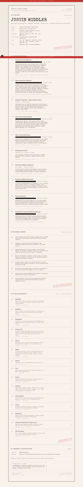
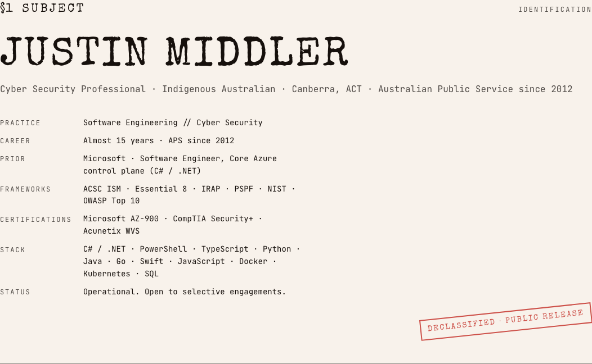
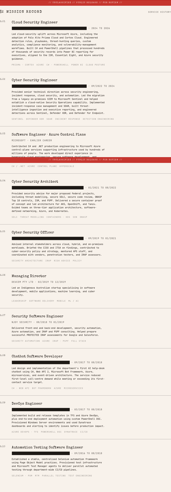
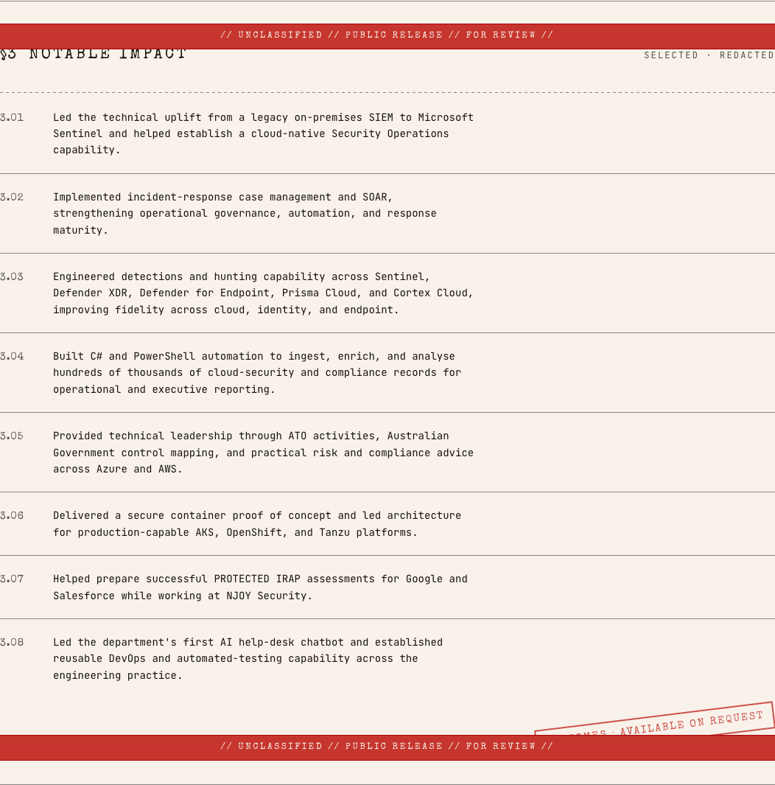
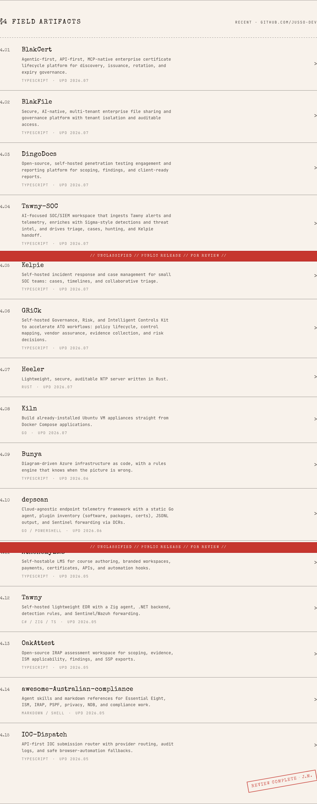
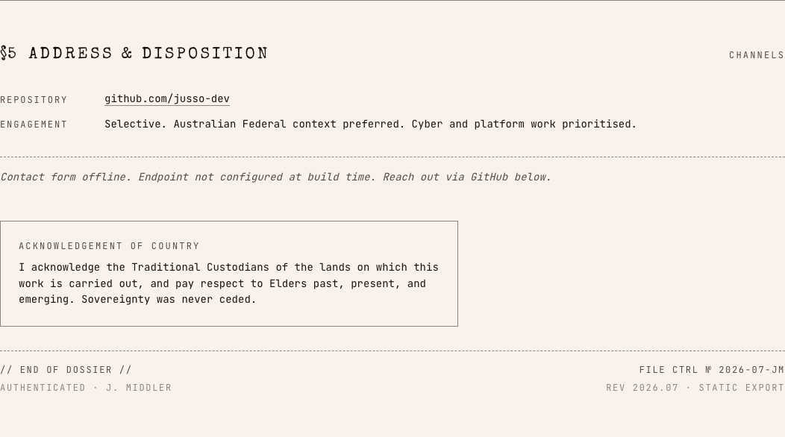

# jussodev-portfolio

Personal portfolio for Justin Middler, an Indigenous Australian cyber security and software engineering practitioner with almost 15 years in and alongside the Australian Public Service, plus prior Microsoft Azure control-plane experience.

Static Next.js site styled as a declassified government dossier. Ships to GitHub Pages.

## Screenshot



<details>
<summary>View the dossier sections</summary>

| Subject profile | Mission record |
| --- | --- |
|  |  |

| Notable impact | Field artifacts |
| --- | --- |
|  |  |

| Contact channels |
| --- |
|  |

</details>

## Local

```bash
npm install
npm run dev        # http://localhost:3000
npm run build      # writes ./out
```

## Deploy

Pushes to `main` build and publish to GitHub Pages via `.github/workflows/deploy.yml`. The workflow sets `BASE_PATH=/<repo-name>` at build time so the site renders correctly under project-page URLs (`https://<user>.github.io/<repo>/`).

For a custom domain or `user.github.io` user-page repo, leave `BASE_PATH` empty.

In the GitHub repo:

1. **Settings → Pages → Build and deployment → Source**: select **GitHub Actions**.
2. Push to `main`. The workflow does the rest.

## Stack

- Next.js 16 (App Router, `output: "export"`)
- React 19
- Tailwind v4 (tokens only; component styles hand-rolled in `globals.css`)
- TypeScript

## Design system

See `PRODUCT.md` and `DESIGN.md` at repo root.
